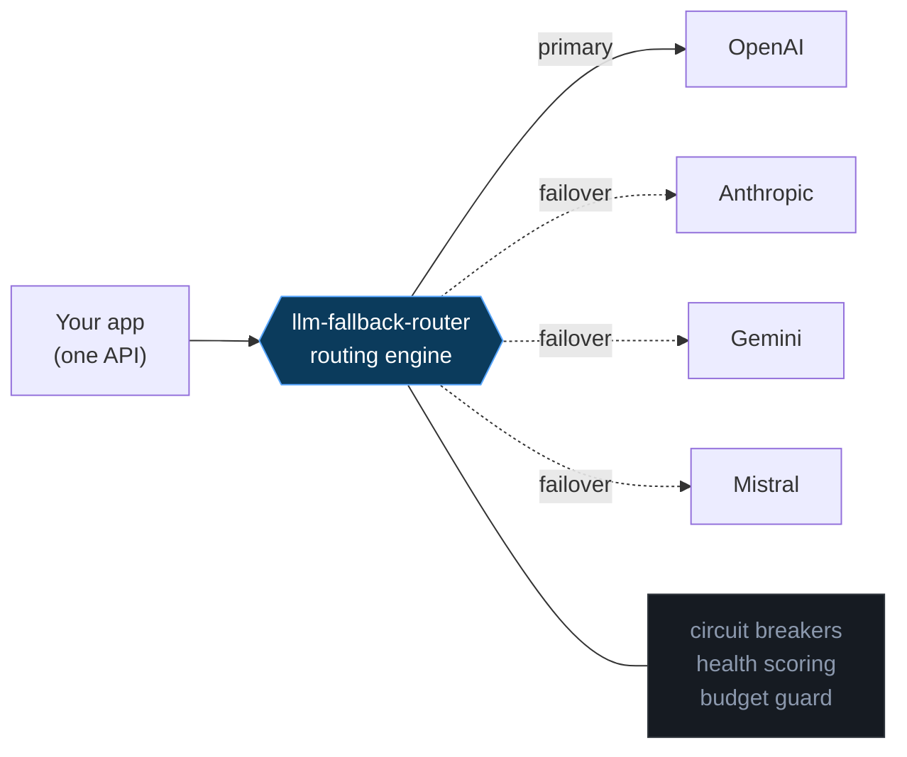
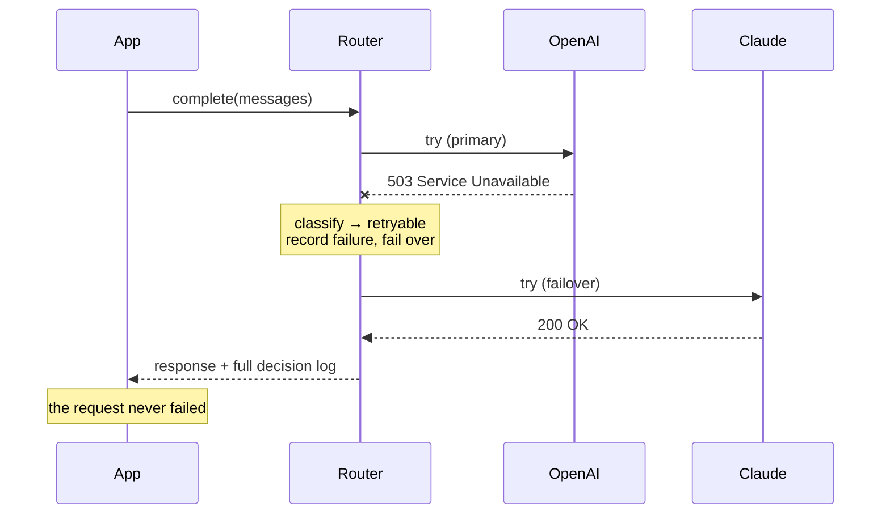
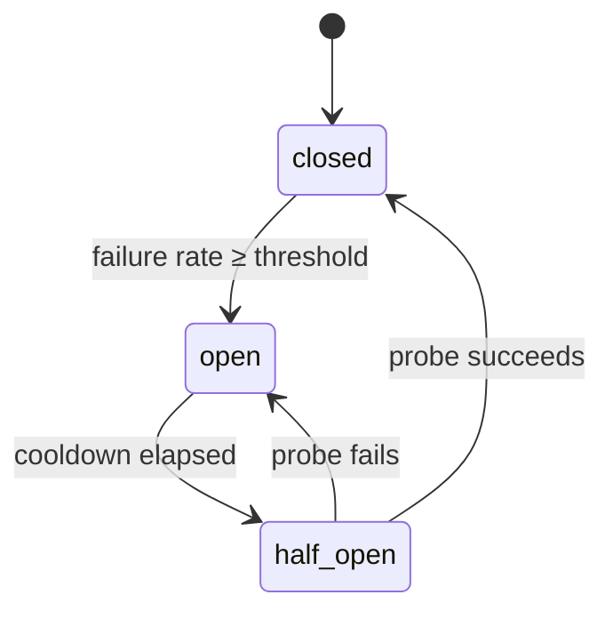

<div align="center">

# ⚡ llm-fallback-router

### Never get a 503 from your AI again.

**Intelligent routing, automatic failover, latency-aware model selection, and cost-controlled fallback across every major LLM provider.**

[](https://github.com/ingridtoulotte/llm-fallback-router/actions/workflows/ci.yml)
[](./LICENSE)
[](https://nodejs.org)
[](#zero-dependencies)
[](#)

One API. Every provider. Automatic intelligence.

</div>

---

```text
 PROVIDER      MODEL                 STATUS        LATENCY   ERRORS  SCORE  HEALTH
 ──────────────────────────────────────────────────────────────────────────────────────
 mistral       mistral-large-latest  ● healthy       429ms     0.0%     98  ██████████
 claude        claude-sonnet-4-6     ● healthy       573ms     0.0%     97  ██████████
 openai        gpt-4o                ● healthy       639ms     2.7%     94  █████████░
 gemini        gemini-2.5-flash      ◐ degraded     2184ms     6.7%     75  ████████░░

 → router selected: claude
```

> `npm run demo` — the scoreboard above is real output, generated from simulated traffic in ~30ms. There's a live web version too (`npm run example:dashboard`).

---

## The problem

Every AI team eventually hits the same wall:

> OpenAI has an outage. Anthropic rate-limits you. Gemini latency spikes to 8 seconds. A model gets deprecated overnight. A runaway loop burns your monthly budget by lunch.

Today, most systems just **fail**. The request errors. The app crashes. The user sees a spinner that never resolves. Revenue and trust evaporate — for an outage you didn't cause and can't control.

You don't control provider uptime. You **can** control what happens when a provider goes down.

`llm-fallback-router` sits between your app and every provider and makes outages *almost invisible*: it detects unhealthy providers, fails over in milliseconds, routes by latency and cost, trips circuit breakers to stop hammering dead endpoints, and hands you a full audit trail of every decision.

---

## How it works



You write to **one** request shape. The router decides — every request — which provider to call, in what order to fall back, and which ones to skip. When the primary fails, it transparently tries the next healthy provider. Your code never changes.



---

## Quick start (under 60 seconds)

```bash
npm install llm-fallback-router
```

```ts
import { Router, openai, anthropic, gemini } from "llm-fallback-router";

const router = new Router({
  providers: [
    { provider: openai({ model: "gpt-4o" }),               priority: 0 },
    { provider: anthropic({ model: "claude-sonnet-4-6" }), priority: 1 },
    { provider: gemini({ model: "gemini-2.5-flash" }),     priority: 2 },
  ],
});

const res = await router.complete({
  messages: [{ role: "user", content: "Explain circuit breakers in one sentence." }],
});

console.log(res.text);
console.log(`served by ${res.provider} in ${res.latencyMs}ms · $${res.costUsd.toFixed(6)}`);
```

That's it. If OpenAI 503s, you get Claude. If Claude is rate-limited, you get Gemini. The caller never sees the failure. API keys are read from `OPENAI_API_KEY`, `ANTHROPIC_API_KEY`, `GEMINI_API_KEY`, `MISTRAL_API_KEY` (or pass `apiKey` explicitly).

No keys handy? Every example falls back to mock providers so you can try it offline:

```bash
git clone https://github.com/ingridtoulotte/llm-fallback-router && cd llm-fallback-router
npm install && npm run demo
```

---

## Features

### 🔁 Automatic failover

A retryable failure (5xx, 429, timeout, network) transparently advances to the next provider. A *non*-retryable one (a malformed `400`) stops immediately — because it would fail everywhere, and retrying just burns money.

```text
$ node examples/failover.mjs
request 1: served by "claude"
   ✗ openai  failed (server_error) — failing over
   ✓ claude  success — failover via "priority"
request 3: served by "openai"          # recovered, primary restored
   ✓ openai  success — selected via "priority"
```

### 🧠 Smart provider selection

Pick a strategy — the router does the rest:

| Strategy | Picks by | Use it for |
|---|---|---|
| `priority` | your declared order | strict provider preference |
| `latency` | fastest EWMA latency | user-facing, latency-critical |
| `cost` | cheapest eligible model | batch / background jobs |
| `weighted` | weighted random | canary, A/B, traffic splitting |
| `balanced` *(default)* | health score − latency | the sensible default |

### 💸 Cost-aware & tier-based routing

Serve premium users a flagship model and everyone else something cheaper — declaratively.

```ts
const router = new Router({
  strategy: "cost",
  budget: { dailyUsd: 50, perRequestUsd: 0.5 },
  providers: [
    { provider: anthropic({ model: "claude-opus-4-8" }),   tiers: ["premium"] },
    { provider: anthropic({ model: "claude-sonnet-4-6" }), tiers: ["premium", "standard"] },
    { provider: gemini({ model: "gemini-2.0-flash" }),     tiers: ["standard", "low"] },
  ],
});

await router.complete({ messages, tier: "premium" });  // → opus/sonnet (cheapest eligible)
await router.complete({ messages, tier: "low" });      // → gemini flash
```

Built-in **pricing table** estimates cost per call; **budgets** (per-request / daily / monthly) skip any provider that would blow the cap and fall back to a cheaper one.

### ⚡ Latency-aware routing & circuit breakers

Every provider has a circuit breaker. After the failure rate crosses a threshold, the breaker **opens** and traffic is skipped *instantly* (no timeout tax). After a cooldown it goes **half-open**, sends a probe, and recovers automatically — preventing one sick provider from dragging down every request.



### 🪓 Traffic splitting

```text
$ node examples/traffic-split.mjs
over 1000 requests:
  stable  82.1%  ▇▇▇▇▇▇▇▇▇▇▇▇▇▇▇▇▇▇▇▇▇▇▇▇▇▇▇▇▇▇▇▇▇
  canary  17.9%  ▇▇▇▇▇▇▇
```

### 🔍 Deterministic, explainable decisions

Every response carries a full `decision` — who was tried, who was skipped, and *why*. No black box.

```jsonc
{
  "chosen": "claude",
  "strategy": "priority",
  "attempts": [
    { "provider": "openai", "outcome": "failed",  "errorKind": "server_error", "reason": "failing over" },
    { "provider": "claude", "outcome": "success", "reason": "failover via \"priority\"", "latencyMs": 612, "costUsd": 0.0009 }
  ],
  "totalLatencyMs": 640,
  "costUsd": 0.0009
}
```

### 📊 First-class observability

- **Terminal scoreboard** — `renderScoreboard(router.scoreboard())` (the screenshot at the top).
- **Live web dashboard + JSON API** — `createDashboardServer(router)` serves a zero-dependency dashboard at `http://127.0.0.1:7575` with `/api/health`, `/api/metrics`, `/api/scoreboard`, `/api/decisions`.
- **Audit log** — `router.decisions()` returns the recent decision ring buffer.
- **`onDecision` hook** — pipe every decision into your own logging/metrics.

### 🧪 Dry-run mode

```ts
const planner = new Router({ providers, dryRun: true });
const plan = await planner.complete({ messages });
// plan.decision.chosen tells you where it WOULD route — no provider called, $0 spent.
```

---

## Why not just…?

| | **llm-fallback-router** | LiteLLM proxy | Hand-rolled `try/catch` | API gateway (Kong/Nginx) | Direct SDK |
|---|:--:|:--:|:--:|:--:|:--:|
| Automatic failover | ✅ | ✅ | ⚠️ you write it | ⚠️ generic | ❌ |
| Circuit breakers (per provider) | ✅ | ⚠️ partial | ❌ | ⚠️ generic | ❌ |
| Latency-aware selection | ✅ | ⚠️ | ❌ | ❌ | ❌ |
| Cost-aware routing + budgets | ✅ | ⚠️ | ❌ | ❌ | ❌ |
| Weighted traffic split / canary | ✅ | ⚠️ | ❌ | ✅ | ❌ |
| Per-request decision audit | ✅ | ❌ | ❌ | ⚠️ logs | ❌ |
| LLM-aware (knows 429/529/models) | ✅ | ✅ | ⚠️ | ❌ | ✅ |
| Runtime dependencies | **0** | many (Python) | 0 | infra | 1+ |
| Runs in-process (no extra hop) | ✅ | ❌ proxy | ✅ | ❌ proxy | ✅ |
| Setup time | **minutes** | hours | hours | days | minutes |

**LiteLLM** is excellent and broad, but it's a Python proxy service — another box to run, scale, and monitor. **Gateways** are LLM-unaware: a 529 "overloaded" looks like any other 5xx and they can't reason about model cost or token budgets. **Hand-rolled failover** works until you need breakers, latency scoring, budgets, and an audit trail — at which point you've rebuilt this, worse.

`llm-fallback-router` is a **library, not a proxy**: it runs *inside* your process, adds [single-digit microseconds](#performance) of overhead, has **zero runtime dependencies**, and is LLM-native.

---

## Enterprise trust

- **Deterministic routing** — same inputs + health state ⇒ same route. Strategies are pure functions; seed the RNG for reproducible traffic splits.
- **Full transparency** — every request explains itself (`response.decision`). Dry-run to preview routes before spending a cent.
- **Cost control** — per-request, daily, and monthly budgets enforced *before* the call.
- **No data exfiltration** — runs in-process; nothing is sent anywhere except the providers you configure. No telemetry, no phone-home.
- **Bounded & safe under load** — rolling windows are capped by sample count, so health/breaker bookkeeping stays O(1) per request even at high QPS.
- **Tested** — 28 deterministic unit/integration tests (failover, breakers, budgets, selection, health), no network required.

---

## Performance

Pure routing overhead, mock providers, single thread (`npm run bench`):

```text
healthy primary (no failover)     3.67 µs/op     272,135 ops/sec
failover to 2nd provider         15.57 µs/op      64,238 ops/sec
open-breaker instant skip         3.69 µs/op     270,715 ops/sec
```

Routing costs single-digit microseconds — negligible next to any real network call. An **open breaker skips a dead provider in ~3.7µs** instead of eating a full timeout.

---

## API at a glance

```ts
const router = new Router({
  providers,                       // RouteTarget[] | ProviderAdapter[]
  strategy: "balanced",            // "priority"|"latency"|"cost"|"weighted"|"balanced"|Strategy
  timeoutMs: 30_000,               // per-attempt timeout
  maxAttempts: 4,                  // cap providers tried per request
  budget:  { dailyUsd, monthlyUsd, perRequestUsd },
  breaker: { failureThreshold: 0.5, cooldownMs: 15_000, minimumRequests: 5 },
  dryRun:  false,
  onDecision: (d) => log(d),       // every decision
});

await router.complete(request);    // → CompletionResponse (+ .decision)
router.health();                   // → HealthSnapshot[]
router.metrics();                  // → MetricsSnapshot
router.scoreboard();               // → Scoreboard
router.decisions();                // → RouteDecision[] (audit ring buffer)
```

**Providers:** `openai`, `anthropic`, `gemini`, `mistral`, `mock` — plus any OpenAI-compatible endpoint via `baseUrl` (Azure, vLLM, Groq, Together, OpenRouter…). Add your own by implementing the tiny `ProviderAdapter` interface.

---

## FAQ

<details>
<summary><b>Is this a proxy I have to deploy?</b></summary>

No. It's an in-process library (`npm install`). No extra service, no network hop, no ops burden. (A standalone gateway mode is on the roadmap for non-Node stacks.)
</details>

<details>
<summary><b>Does failover work mid-stream?</b></summary>

v1 targets non-streaming `complete()` with full failover. Streaming support (with pre-first-token failover) is on the roadmap.
</details>

<details>
<summary><b>What about different prompt formats per provider?</b></summary>

You write one provider-agnostic `CompletionRequest`. Each adapter maps it to that provider's wire format — Anthropic's `system` field, Gemini's `user/model` roles, etc. — automatically.
</details>

<details>
<summary><b>How are costs calculated?</b></summary>

A built-in pricing table (USD per 1M tokens) estimates cost per call. Prices change often and are *not* authoritative — override any model with `registerPrice()`. Unknown models cost `$0` and are flagged by `isPriced()` so you can tell "free" from "unpriced".
</details>

<details>
<summary><b>Won't it retry a request that's broken anyway?</b></summary>

No. A `400/422` (`bad_request`) is classified non-retryable and stops the chain immediately — it would fail on every provider. Only transient failures (`429`, `5xx`, `529`, timeouts, network) trigger failover.
</details>

<details>
<summary><b>Is it deterministic / testable?</b></summary>

Yes. The clock and RNG are injectable, strategies are pure, and the whole suite runs offline against mock providers. See `test/`.
</details>

---

## Roadmap

v1 is intentionally focused: **excellent core routing**, not feature bloat. Next:

- [ ] Streaming responses with pre-first-token failover
- [ ] Self-hosted / Ollama / local model adapters
- [ ] Standalone gateway mode (HTTP proxy for non-Node stacks)
- [ ] Regional routing & compliance constraints (first-class)
- [ ] Prometheus / OpenTelemetry exporters
- [ ] Persistent metrics + provider benchmarking
- [ ] Declarative YAML policy files

---

## Contributing

PRs welcome — see [CONTRIBUTING.md](./CONTRIBUTING.md). Adding a provider is ~40 lines: implement `ProviderAdapter`, map the request/response, done.

```bash
npm install
npm test        # build + 28 tests, offline
npm run demo    # the scoreboard
npm run bench   # routing overhead
```

## Zero dependencies

No runtime dependencies. Just built-in `fetch` (Node 18+) and the standard library. The only dev dependencies are `typescript` and `@types/node`.

## License

[MIT](./LICENSE) © contributors
